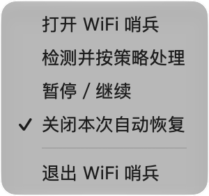
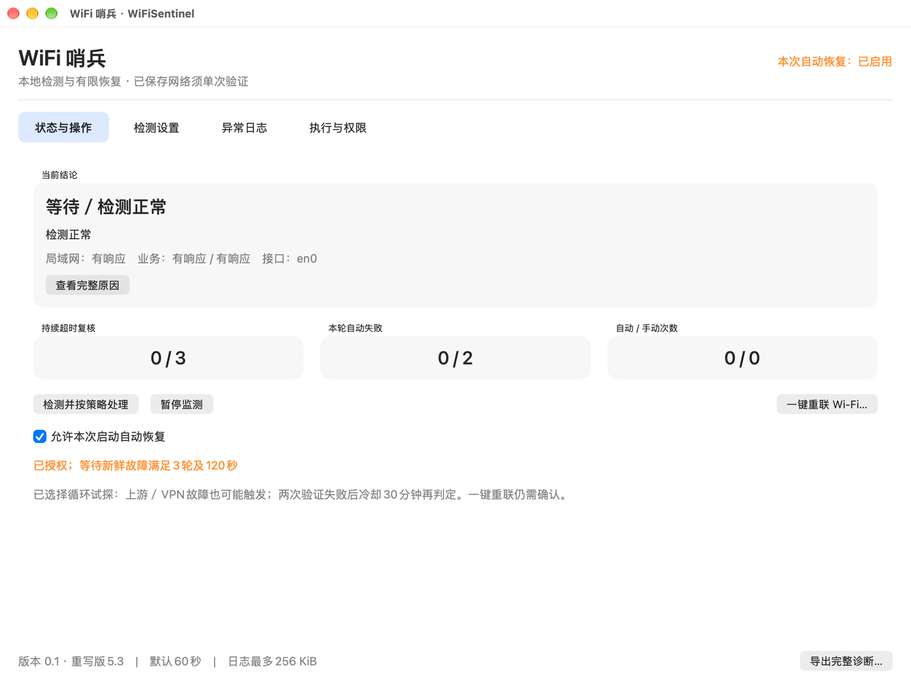
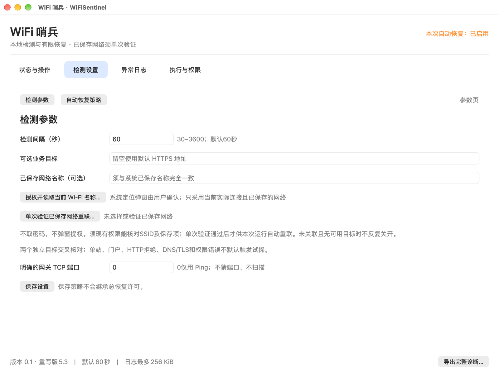

本文由CODEX全自动编写。

# WiFi 哨兵 · WiFiSentinel

一个借助 AI 开发的 macOS 菜单栏小工具，帮你留意 Wi-Fi 的连接和上网状态，并在你允许时尝试恢复连接。

## 为什么做这个工具

在 Wi-Fi 信号不太好的地方，比如离路由器较远、隔着几堵墙的位置，有时会遇到连接不稳定，或者 Wi-Fi 看起来还连着，网页却迟迟打不开。每次都要打开系统菜单查看、等待重连，甚至手动关开 Wi-Fi，很打断手头的事情。

WiFi 哨兵想帮你少做一些这样的重复操作：平时待在菜单栏，定期检查连接；出现异常时，展示检查结果；经过你的确认后，再按条件尝试恢复。

信号、路由器、运营商和 VPN 都可能影响上网，处理办法并不相同。哨兵不会增强无线信号，也不能修好所有断网问题。

## 能帮你做什么

| 功能 | 使用时会看到什么 |
| --- | --- |
| 菜单栏常驻 | 一双小眼睛守在 Wi-Fi 图形上方。点击图标，可打开窗口、暂停监测或管理本次自动恢复。 |
| 分开检查连接与上网 | 同时查看 Wi-Fi 是否关联、局域网是否响应，以及两个独立外网目标是否响应，避免只凭一个网站打不开就下结论。 |
| 展示当前状态 | 主窗口显示检测结论、原因、故障复核进度和自动／手动恢复次数；长原因可以展开查看。 |
| 可选自动恢复 | 每次启动默认关闭。你在应用里确认后，持续故障满足条件才会尝试；连续失败后进入冷却，避免密集反复关开。 |
| 手动尝试重联 | “一键重联 Wi-Fi…”会先要求确认。执行后还会检查实际连接和联网结果，不把命令执行完当作修复成功。 |
| 按需要调整检测 | 可改检测间隔、设置一个自定义业务目标，也可选择恢复策略。默认每 60 秒检测一次。 |
| 留下异常记录 | “异常日志”记录异常与恢复阶段，支持查看详情、翻页和导出诊断；日志有大小上限，正常检测不会不断追加日志。 |

## 界面长这样

以下为真实运行截图：网络正常，恢复次数为 0。截图中的自动恢复已开启；**新启动的应用仍默认关闭，需要你自己确认**。

### 菜单栏入口

图标实际大小为 20 pt，适配深浅色菜单栏和 Retina。点击后即可打开菜单：




### 状态与操作

先看“当前结论”，再看局域网与两个业务目标的响应。下方能区分故障复核进度和实际恢复次数。



### 检测设置

大多数情况下可以先保留默认值，业务目标和已保存网络名称都是可选项。



## 安装并运行

目前提供源码，还没有可直接下载的正式安装包。DMG 需要完成 Apple 公证和系统验证后才会在 Releases 提供；当前缺少可用的公证认证，暂不发布安装包。实际状态见[签名与分发说明](docs/DISTRIBUTION.md)。

构建目标最低为 **macOS 13**，需要带 Swift 5.9 或更新编译器的 Xcode Command Line Tools、Python 3 和 zsh。当前实测主机为 Apple Silicon（arm64）和 macOS 27.0.1；较早系统与 Intel 尚未实机验证。

如果尚未安装 Apple 开发工具，可先运行 `xcode-select --install`，按系统提示完成安装。然后在终端执行：

```sh
git clone https://github.com/ailifelab/WiFiSentinel.git
cd WiFiSentinel
/bin/zsh scripts/build.sh
open build/candidates/rewrite5-exit0/WiFiSentinel.app
```

构建好的 `.app` 位于上面的候选目录。准备长期使用时，可以在正常退出后将它复制到自己的 `~/Applications/` 中，再从那里打开。更新前请留一份旧应用，具体见[安装、卸载与回滚](docs/INSTALL.md)。

自行构建的应用没有正式发行签名或公证。遇到 macOS 安全提示，请先核对来源；不要为运行它关闭系统安全检查。

## 怎么用

1. **先观察。** 打开应用后，在“状态与操作”查看当前结论。保持自动恢复关闭，也能定期检测和查看异常记录。关闭主窗口后，仍可从菜单栏图标重新打开。
2. **需要时调整检测。** 在“检测设置 → 检测参数”修改间隔，或填写自己关心的业务地址，再点“保存设置”。普通使用不必填写已保存网络或网关端口。
3. **按需开启自动恢复。** 在“状态与操作”勾选“允许本次启动自动恢复”，阅读弹窗后确认。每次重新启动都需要再确认；保存设置不会自动开启这个总开关。
4. **想手动尝试时先确认影响。** 点击“一键重联 Wi-Fi…”后会弹出确认。它可能短暂关开 Wi-Fi，中断视频会议、下载、SSH 和 VPN，适合在可以接受中断时使用。
5. **没有恢复时查看原因。** “异常日志”可查看异常详情；“执行与权限”会显示实际执行结果和是否需要人工处理。向别人分享导出诊断前，先删除网络名称、地址等私人信息。

“检测并按策略处理”会立即发起检测；如果你已启用自动恢复，它也可能按当前策略触发恢复。只想观察时，请保持自动恢复关闭。

### 两种自动恢复策略

- **默认保守策略：** 持续故障需要多轮复核；局域网仍正常时，不会仅因外网异常就自动关开 Wi-Fi。
- **上网异常循环恢复：** 在“检测设置 → 自动恢复策略”中选择并保存。两个外网目标持续超时，即使局域网正常也可能尝试，因此上游或 VPN 故障也可能触发。只有能接受连接被打断时再考虑开启。

两种策略都要等待至少三轮、持续至少 120 秒的符合条件的故障。连续两次自动恢复验证失败后，会冷却 30 分钟清醒时间，再重新判断。遇到“需要处理”或重新开启未确认的提示，请先到系统 Wi-Fi 菜单检查。

需要指定某个已保存网络时，再看[可选的网络重联设置](docs/USAGE.md)；它需要额外核对权限和单次验证，普通使用可以先跳过。

## 使用前知道这些就够了

- 自动恢复和手动重联都可能打断当前无线连接。不能接受中断时，可以只开监测。
- 软件不会修改 VPN、DNS、路由或已保存网络配置，也不读取 Wi-Fi 密码。默认外网检测会访问 Apple 和 Cloudflare；设置和日志保存在本机，详见[隐私说明](docs/PRIVACY.md)。
- 真实断网后的自动恢复、指定网络重联及系统返回 `-3900` 的情况仍未充分验证。稳定运行不等于已经验证所有恢复场景；技术细节放在[验证范围与已知限制](docs/VALIDATION.md)。

问题和建议欢迎提交到 [Issues](https://github.com/ailifelab/WiFiSentinel/issues)。涉及安全问题请先看[安全反馈说明](SECURITY.md)，不要公开私人诊断数据。

## 许可证

[MIT License](LICENSE) · [依赖与第三方说明](THIRD_PARTY_NOTICES.md)
